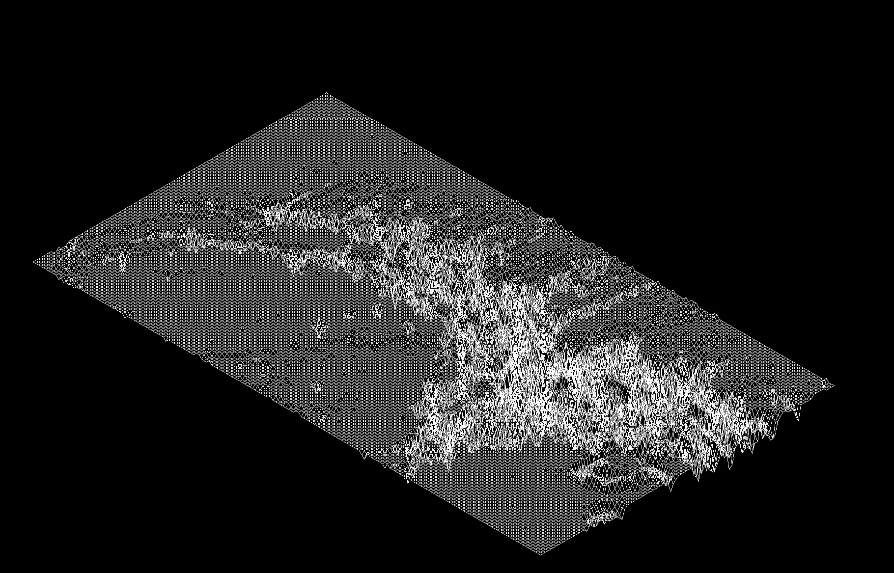

# FdF — wireframe height maps

Reads a grid of altitudes and draws it as an isometric wireframe landscape, in C with the MiniLibX
(a small X11 graphics library). School 19 (42 network) project.



## What it does

- Parses `.fdf` maps (one altitude per point) with error checks on malformed or ragged lines.
- Projects every point with an isometric transform, scales and centres the map to fit the window.
- Draws the segments between neighbours with Bresenham's line algorithm, straight into the image buffer.
- Large maps (the bundled `julia.fdf` and `elem-fract.fdf` are 2.8 MB each) are read in chunks into a
  growing buffer before parsing.
- `Esc` or the window's close button quits and frees everything.

## Build and run

Needs `make`, a C compiler and the X11 development packages
(`libx11-dev libxext-dev libbsd-dev` on Debian/Ubuntu). The MiniLibX and my libft are bundled in `resources/`.

```bash
make
./fdf resources/maps/mars.fdf
```

About 20 test maps are in `resources/maps/` (`42.fdf`, `pyramide.fdf`, `julia.fdf`…).
